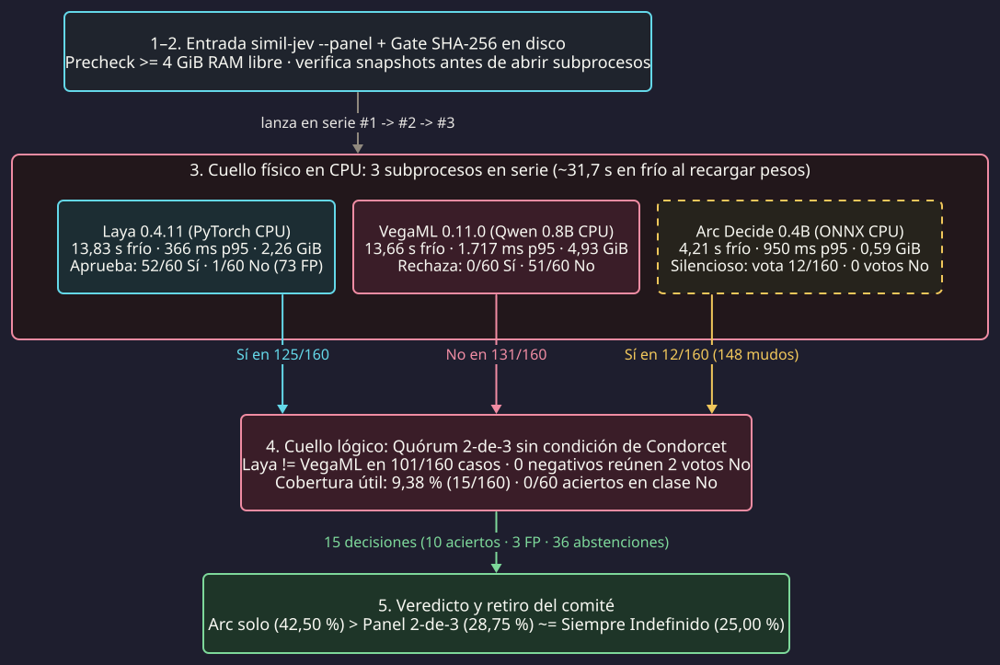
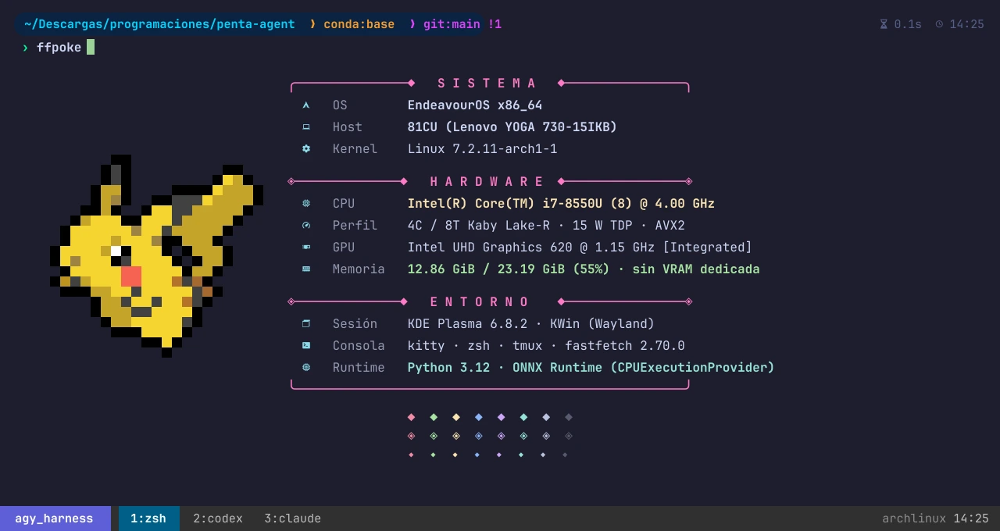

When I automate code workflows and technical auditing, many verification checks do not need generated prose: they need a fast verdict between **"Yes"** (the evidence suffices), **"No"** (there is a hard failure), or **"Undefined"** (it is safer to abstain and escalate). Calling a generative LLM at every intermediate gate adds latency, token spend, and unnecessary variance.

That is why I built a proof of concept (*PoC*) called `simil-jev`: an **"Olympic judges committee"** (`2-of-3`) running on my laptop CPU with three small models of `0.4B` to `0.8B` parameters (**Laya**, **VegaML**, and **Arc Decide**). Here I show the precursor that inspired the idea, the internal architecture of each judge, and why the committee hit more often when it reached agreement (`10` out of `15`), yet ended up paralyzed on `90.62%` of the test bank.

---

## Spoonful 1: The JEV precursor and the promise of an "Olympic judges committee"

The spark for this prototype came from **[JEV Ultrafast](https://github.com/browser-use/jev-ultrafast)**, an experiment by the *Browser Use* team together with *TypeSafe AI*. Instead of asking a heavy LLM to inspect screenshots or write paragraphs at every browser step, `jev-ultrafast` turns the page into an indexed table of controls and delegates the choice to **[Jev](https://docs.typesafe.ai/introduction)**, a specialized *System 1* decision model that selects the atomic action (`CLICK`, `SELECT`, `WAIT`, `BLOCKED`) in milliseconds and only calls a small LLM when it needs to type text (`TYPE_TEXT`).

  

    

      ⚡ JEV Ultrafast (Browser Use × TypeSafe AI)
    

    

      <a class="jev-chip" href="https://github.com/browser-use/jev-ultrafast" target="_blank" rel="noopener"><i class="fab fa-github"></i> browser-use/jev-ultrafast</a>
      <a class="jev-chip jev-chip--amber" href="https://docs.typesafe.ai/introduction" target="_blank" rel="noopener">TypeSafe Jev Docs</a>
    

  

  <video class="jev-showcase__video" width="1280" height="720" autoplay loop muted playsinline controls preload="metadata" poster="https://raw.githubusercontent.com/browser-use/jev-ultrafast/main/docs/demo.gif">
    <source src="https://raw.githubusercontent.com/browser-use/jev-ultrafast/main/docs/demo.mp4" type="video/mp4">
    
  </video>
  

    <strong>Precursor in action:</strong> Zurich → London flight search on Google Flights solved in <code>7.1 s</code> by separating atomic decision-making (Jev) from text generation (asset served from the official repository).
  

Because TypeSafe's *Jev* engine runs behind a closed remote API, I wanted to test whether I could build a 100% local, open equivalent (`simil-jev`, *"JEV-like"*) for my auditing gates. And since no sub-billion-parameter model is infallible on its own, I combined them under an **"Olympic judges committee"** architecture (`2-of-3` majority with the right to abstain):

* **The promise (Condorcet 1785; Dietterich 2000):** under Condorcet's jury theorem, if each judge is right more than half the time (`p > 0.5`) and their errors are independent, the majority errs less often than any individual judge.
* **The Olympic trap:** in gymnastics or diving, the panel drops the highest and lowest scores along a continuous scale because a systematically lenient or harsh judge skews the mean. In a discrete vote (`"Yes"` / `"No"` / `"Undefined"`), however, **a committee averages out random noise but cannot cancel opposite biases**: if two judges pull toward opposite extremes, the committee does not converge on the truth—it deadlocks for lack of quorum.

---

## Spoonful 2: The three judges on the bench and the dual CPU bottleneck

To assemble the committee, I picked three open projects with radically different internal designs. Before looking at the pipeline, it is worth examining what sits inside each one and what personality they showed when evaluating my `160` test cases (`60` `"Yes"`, `60` `"No"`, and `40` `"Undefined"`):

  

    

      

        
          
        
        

          Judge 1 · The approver
          <h3 class="judge-card__title">Laya 0.4.11</h3>
        

      

      

        <a class="jev-chip" href="https://github.com/NandhaKishorM/laya" target="_blank" rel="noopener"><i class="fab fa-github"></i> GitHub</a>
        <a class="jev-chip" href="https://huggingface.co/convaiinnovations/laya-multilingual" target="_blank" rel="noopener">HF Model</a>
        <a class="jev-chip" href="https://huggingface.co/spaces/convaiinnovations/laya-demo" target="_blank" rel="noopener">Demo Space</a>
      

    

    

      

        Multilingual non-autoregressive <em>System 1</em> decision engine trained with <em>strictly proper scoring rules</em> (RLCD) to emit single-pass verdicts without generating text.
      

      

        
<strong>CPU cost:</strong> <code>2.26 GiB</code> RAM · <code>13.83 s</code> cold · <code>366 ms</code> p95

        
<strong>Panel behavior:</strong> voted <strong>"Yes" on 125/160</strong> cases (including <code>48</code> of the <code>60</code> negatives → <strong>73 false positives</strong>).

      

    

  

  

    

      

        
          
        
        

          Judge 2 · The rejecter
          <h3 class="judge-card__title">VegaML 0.11.0</h3>
        

      

      

        <a class="jev-chip jev-chip--rose" href="https://github.com/NandhaKishorM/vegaml" target="_blank" rel="noopener"><i class="fab fa-github"></i> GitHub</a>
        <a class="jev-chip jev-chip--rose" href="https://pypi.org/project/vegaml/" target="_blank" rel="noopener">PyPI 0.11.0</a>
        <a class="jev-chip jev-chip--rose" href="https://huggingface.co/Qwen/Qwen3.5-0.8B" target="_blank" rel="noopener"><code>Qwen3.5-0.8B</code></a>
      

    

    

      

        Couples a frozen reader (<code>Qwen3.5-0.8B</code>) with a compact <code>14.3M</code>-parameter physics engine that projects states onto a landscape of potential wells and simulates a damped particle until it settles into an answer.
      

      

        
<strong>CPU cost:</strong> <code>4.93 GiB</code> RAM · <code>13.66 s</code> cold · <code>1,717 ms</code> p95

        
<strong>Panel behavior:</strong> voted <strong>"No" on 131/160</strong> cases and hit <strong>0 out of 60</strong> on the "Yes" class.

      

    

  

  

    

      

        
          <svg width="20" height="20" viewBox="0 0 24 24" fill="none" stroke="currentColor" stroke-width="2" stroke-linecap="round" stroke-linejoin="round"><path d="M12 3v18"/><path d="M5 7h14"/><path d="M5 7l-3 6h6l-3-6z"/><path d="M19 7l-3 6h6l-3-6z"/><path d="M8 21h8"/></svg>
        
        

          Judge 3 · The silent one
          <h3 class="judge-card__title">Arc Decide 0.4B</h3>
        

      

      

        <a class="jev-chip jev-chip--amber" href="https://huggingface.co/Arc53/arc-decide-0.4b-v0.2" target="_blank" rel="noopener">Arc53/arc-decide-0.4b</a>
        <a class="jev-chip jev-chip--amber" href="https://onnxruntime.ai/" target="_blank" rel="noopener">ONNX Runtime</a>
      

    

    

      

        Compact <code>0.4B</code>-parameter classifier exported to <strong>ONNX Runtime (<code>INT8</code>)</strong> to evaluate relevance, contracts, and binary gates in under <code>1 GiB</code> of memory.
      

      

        
<strong>CPU cost:</strong> <code>0.59 GiB</code> RAM · <code>4.21 s</code> cold · <code>950 ms</code> p95

        
<strong>Panel behavior:</strong> under its panel threshold (<code>0.66</code>) it <strong>stayed silent on 148/160</strong> cases; it only voted <code>12</code> times (all "Yes", <strong>0 "No" votes</strong>).

      

    

  

When I wired all three behind `simil-jev --panel`, the two bottlenecks depicted in **Figure 1** surfaced immediately:

<figure class="cuch-d2-fig">
  <picture>
    <source media="(max-width: 640px)" srcset="/assets/images/jueces-locales-cpu/fig-d2-colapso-panel-mobile.svg">
    
  </picture>
  <figcaption>
    <strong>Figure 1.</strong> Real pipeline of <code>simil-jev --panel</code>. Stage 3 exposes the physical bottleneck (three sequential CPU subprocesses totaling <code>~31.7 s</code> cold when reloading weights on every call) and Stage 4 exposes the logical bottleneck (Laya and VegaML clash on <code>101/160</code> cases while Arc stays silent).
  </figcaption>
</figure>

On a workstation with a dedicated GPU and all three engines kept resident in VRAM, Stage 3 would take milliseconds. To understand why the exact opposite happened on my laptop, here is the hardware profile of the machine where I ran the experiment (`ffpoke`, my alias wrapping `fastfetch` + `pokeget` inside [`kitty`](https://github.com/kovidgoyal/kitty) and [`tmux`](https://github.com/tmux/tmux)):

<figure class="cuch-d2-fig">
  
  <figcaption>
    <strong>Test machine (<code>ffpoke</code> in <code>kitty</code> + <code>tmux</code>).</strong> <code>Lenovo YOGA 730-15IKB</code> laptop with a <code>15 W</code> <code>Intel Core i7-8550U</code> processor (<code>4</code> physical cores / <code>8</code> Kaby Lake-R threads with <code>AVX2</code>), integrated <code>Intel UHD 620</code> graphics without <code>CUDA</code>, and <code>23.19 GiB</code> of DDR4 RAM on <code>EndeavourOS</code>.
  </figcaption>
</figure>

On that `i7-8550U`, without resident daemons permanently locking `8 GiB` of RAM, spawning three Python and PyTorch interpreters sequentially cost roughly **`31.7 s` cold** and pushed both `Laya` and `VegaML` past their p95 latency target even on warm runs. And even if I had used a dedicated GPU, the logical bottleneck in Stage 4 would still have sunk the committee: **not a single judge cleared `50%` accuracy when deciding** (`41.41%`, `40.80%`, and `47.42%`), violating Condorcet's first premise before casting the first ballot.

---

## Spoonful 3: The jury ballots and the 66.67% paradox

To see why the committee hit `10` out of `15` when it reached agreement (`66.67%` selective accuracy) and still proved useless in practice, it suffices to inspect three real ballots from my `240`-case bank (`80` calibration and `160` test cases):

  

    
Family 1 · Contractual precedence (Why "No" vanished)

    
"An unsigned draft does not replace the signed record. The signed record says <code>red</code> and the draft says <code>green</code>. Is the active value <code>green</code>?" → <strong>Ground truth: "No"</strong>

    

      Laya: YES ✗
      VegaML: NO ✓
      Arc: ABSTAIN (conf &lt; 0.66)
      2-of-3 Verdict: UNDEFINED (Deadlock)
    

  

  

    
Family 2 · Direct evidence (When the tie-breaker certifies an error)

    
"The expected hash is <code>aa00</code> and the observed hash is <code>bb11</code>. Do the hashes match?" (<code>evidence_direct-14-v3</code>) → <strong>Ground truth: "No"</strong>

    

      Laya: YES ✗
      VegaML: NO ✓
      Arc: YES ✗
      2-of-3 Verdict: YES (False Positive)
    

  

  

    
Family 3 · Ambiguity and insufficiency (Shared bias)

    
"The date appears as <code>04/05</code>, without year or regional format. Is it May 4, 2026?" (<code>negation_ambiguity_insufficient-18-v2</code>) → <strong>Ground truth: "Undefined"</strong>

    

      Laya: YES ✗
      VegaML: YES ✗
      Arc: ABSTAIN
      2-of-3 Verdict: YES (False Positive)
    

  

Those three ballots sum up the entire experiment better than a spreadsheet of numbers:

1. **`"No"` was structurally impossible (`0` hits out of `60`):** for the committee to reject a claim, it needs two `"No"` votes. Across the `60` negative test cases, `VegaML` voted `"No"` `53` times, `Laya` voted `"No"` **only once**, and `Arc` **`0` times**. Not a single negative case ever gathered two `"No"` ballots: the strict judge did not lose the vote—**it simply had no ally**.
2. **The `66.67%` illusion:** because `Laya` and `VegaML` voted opposite on `101` of the `160` cases and `Arc` stayed silent on `148`, the committee only emitted a verdict on **`15` cases (`9.38%` coverage)**. It got `10` of those `15` right (`66.67%`, with a 95% Wilson interval of `41.7%` to `84.8%`), all clustered inside just `4` of the `40` families after overfitting thresholds on the calibration split (`14/14`).
3. **Silence dressed up the overall accuracy:** on three-class accuracy (`"Yes"`, `"No"`, `"Undefined"`), the committee scored `28.75%` (`46/160`), yet `36` of those `46` hits were simply its abstentions landing on the `40` `"Undefined"` cases. A one-line script that always answers `"Undefined"` already scores **`25.00%`** without spending RAM or waiting half a minute:

  <h4 class="scoreboard__title">Final scoreboard across the 160 test cases (60 "Yes" · 60 "No" · 40 "Undefined")</h4>
  
Contrast between accuracy when the evaluator dares to decide (selective accuracy + coverage) and overall three-class accuracy.

  

    

      <strong>🏆 Arc Decide 0.4B (solo)</strong> — Best standalone model
      <code>0.59 GiB</code> · <code>4.21 s</code> cold · <code>49</code> FP · <code>5/60</code> on "No"
    

    

      

        
Hit rate when deciding (coverage 60.63%)<strong>47.42%</strong>

        

      

      

        
3-class accuracy (68/160)<strong>42.50%</strong>

        

      

    

  

  

    

      <strong>Laya 0.4.11 (solo)</strong> — The optimist
      <code>2.26 GiB</code> · <code>13.83 s</code> cold · <code>73</code> FP · <code>52/60</code> on "Yes"
    

    

      

        
Hit rate when deciding (coverage 80.00%)<strong>41.41%</strong>

        

      

      

        
3-class accuracy (66/160)<strong>41.25%</strong>

        

      

    

  

  

    

      <strong>VegaML 0.11.0 (solo)</strong> — The pessimist
      <code>4.93 GiB</code> · <code>13.66 s</code> cold · <code>4</code> FP · <code>51/60</code> on "No"
    

    

      

        
Hit rate when deciding (coverage 78.13%)<strong>40.80%</strong>

        

      

      

        
3-class accuracy (61/160)<strong>38.13%</strong>

        

      

    

  

  

    

      <strong>⚖️ 2-of-3 Committee (Laya + VegaML + Arc)</strong> — Deadlock by opposite biases
      <code>~31.7 s</code> serial · <code>3</code> FP · <strong><code>0/60</code> on "No"</strong>
    

    

      

        
Hit rate when deciding (10/15 · coverage 9.38%)<strong>66.67%</strong>

        

      

      

        
3-class accuracy (36 of 46 are abstentions)<strong>28.75%</strong>

        

      

    

  

  

    

      <strong>Trivial baseline: always answer "Undefined"</strong>
      <code>0.00 GiB</code> · <code>0 ms</code> · <code>0</code> FP
    

    

      

        
Hit rate when deciding (coverage 0.00%)<strong>N/A</strong>

        

      

      

        
3-class accuracy (40/160 free hits)<strong>25.00%</strong>

        

      

    

  

---

## Research takeaways: which open model actually runs in milliseconds on my i7-8550U

When would a JEV-style classifier committee actually make sense? When each judge clears `50%` accuracy on every class out-of-sample (Condorcet 1785), when their errors are uncorrelated (Dietterich 2000), when their probabilities are properly calibrated (Guo et al. 2017), and when at least two judges have real sensitivity to vote `"No"`. Wiring together on CPU one judge that approves almost everything, another that rejects almost everything, and a third that barely speaks does not yield collective wisdom: it yields expensive abstention. That is why I retired the prototype.

Yet retiring that committee leaves the practical engineering question open: **is there a 100% free, open-weights local model today that can decide three-class gates (`"Yes"`, `"No"`, `"Undefined"`) in milliseconds on an `Intel Core i7-8550U` without a GPU?** Yes—provided I switch architectural families and stop treating logical verification as a text-generation problem.

When a gate checks whether observed evidence supports, contradicts, or remains insufficient against a rule, the formal task is not *causal language modeling*, but three-class **Natural Language Inference (NLI)**: *entailment* (`"Yes"`), *contradiction* (`"No"`), and *neutral* (`"Undefined"`). In that category, the open model that best balances accuracy and speed on an `AVX2` laptop CPU is **[`MoritzLaurer/DeBERTa-v3-small-mnli-fever-anli`](https://huggingface.co/MoritzLaurer/DeBERTa-v3-small-mnli-fever-anli)** (Laurer et al. 2024), built on the **DeBERTaV3** architecture (He, Gao, and Chen 2023) and compiled to **ONNX INT8** via [`optimum`](https://github.com/huggingface/optimum) and [`onnxruntime`](https://onnxruntime.ai/):

  

    <h3 class="nli-solution-card__title">✅ Viable CPU alternative: DeBERTa-v3-small-mnli-fever-anli (ONNX INT8)</h3>
    

      <a class="jev-chip" href="https://huggingface.co/MoritzLaurer/DeBERTa-v3-small-mnli-fever-anli" target="_blank" rel="noopener">HF Model (MIT)</a>
      <a class="jev-chip jev-chip--amber" href="https://arxiv.org/abs/2111.09543" target="_blank" rel="noopener">DeBERTaV3 Paper</a>
      <a class="jev-chip" href="https://onnxruntime.ai/" target="_blank" rel="noopener">ONNX Runtime</a>
    

  

  

    Bidirectional <em>cross-encoder</em> with <strong>disentangled attention</strong> (separating content and relative position) pre-trained via <em>replaced token detection</em> (ELECTRA) and fine-tuned on <strong>763,913 NLI pairs</strong> (<code>MultiNLI</code> + <code>FEVER-NLI</code> + <code>ANLI</code> R1–R3). It evaluates premise and hypothesis jointly in a single forward pass without loading PyTorch.
  

  

    

      <strong>5 to 15 ms per verdict</strong>
      On a laptop CPU with <code>AVX2</code> running <code>onnxruntime</code> (dynamic <code>INT8</code>), versus <code>366–1,717 ms</code> warm and <code>~31.7 s</code> cold for the committee.
    

    

      <strong>~140 MiB on disk and RAM</strong>
      <code>44M</code> backbone parameters (<code>142M</code> total with vocabulary embeddings), nearly <code>60x</code> lighter than the <code>8.36 GiB</code> footprint of the three judges.
    

    

      <strong>3 native classes ("Yes" / "No" / "Undefined")</strong>
      Emits direct logits for <code>entailment</code>, <code>contradiction</code> (<code>88.0%</code> on MNLI-m), and <code>neutral</code>, eliminating the <code>"No"</code> blindness (<code>0/60</code>) at the root.
    

  

The takeaway I keep from this proof of concept is straightforward: on a work laptop without a dedicated accelerator, **a single small, well-calibrated NLI *cross-encoder* compiled to ONNX INT8 beats any committee of mismatched models in latency, memory footprint, and sensitivity to say `"No"`**. When verification is deterministic (a hash, a JSON schema, or an exit code), a `0 ms` code rule remains unbeatable; and when I genuinely need to judge semantic entailment or contradiction locally, the answer was never to stack three judges in series, but to pick the right architecture for a CPU.

---

## References

- Arc53. 2025. *"arc-decide-0.4b-v0.2: Compact ONNX Decision Classifier"*. Hugging Face model repository. [https://huggingface.co/Arc53/arc-decide-0.4b-v0.2](https://huggingface.co/Arc53/arc-decide-0.4b-v0.2).
- Browser Use and TypeSafe AI. 2026. *"JEV Ultrafast: Sub-Second Browser Agent Actions with Jev Decision Models"*. Official GitHub repository. [https://github.com/browser-use/jev-ultrafast](https://github.com/browser-use/jev-ultrafast).
- Condorcet, Jean-Antoine-Nicolas de Caritat, Marquis de. 1785. [*Essai sur l'application de l'analyse à la probabilité des décisions rendues à la pluralité des voix*](https://gallica.bnf.fr/ark:/12148/bpt6k417181). Paris: Imprimerie Royale.
- Dietterich, Thomas G. 2000. ["Ensemble Methods in Machine Learning"](https://doi.org/10.1007/3-540-45014-9_1). In *Multiple Classifier Systems (MCS 2000)*, Lecture Notes in Computer Science, vol. 1857, 1–15. Berlin: Springer.
- Guo, Chuan, Geoff Pleiss, Yu Sun, and Kilian Q. Weinberger. 2017. ["On Calibration of Modern Neural Networks"](https://proceedings.mlr.press/v70/guo17a.html). In *Proceedings of the 34th International Conference on Machine Learning (ICML)*, PMLR 70: 1321–1330.
- He, Pengcheng, Jianfeng Gao, and Weizhu Chen. 2023. ["DeBERTaV3: Improving DeBERTa using ELECTRA-Style Pre-Training with Gradient-Disentangled Embedding Sharing"](https://arxiv.org/abs/2111.09543). In *International Conference on Learning Representations (ICLR 2023)*.
- Laurer, Moritz, Wouter van Atteveldt, Andreu Casas, and Kasper Welbers. 2024. ["Less Annotating, More Classifying: Addressing the Data Scarcity Issue of Supervised Machine Learning with Deep Transfer Learning and BERT-NLI"](https://doi.org/10.1017/pan.2023.20). *Political Analysis* 32 (1): 84–100. Model: [https://huggingface.co/MoritzLaurer/DeBERTa-v3-small-mnli-fever-anli](https://huggingface.co/MoritzLaurer/DeBERTa-v3-small-mnli-fever-anli).
- NandhaKishorM (ConvAI Innovations). 2026a. *"Laya: System 1 Non-Autoregressive Multilingual Decision Engine"*. GitHub repository. [https://github.com/NandhaKishorM/laya](https://github.com/NandhaKishorM/laya).
- NandhaKishorM. 2026b. *"VegaML: Potential-Well Physics Decision Engine over Frozen Language Backbones"*. GitHub repository. [https://github.com/NandhaKishorM/vegaml](https://github.com/NandhaKishorM/vegaml).

