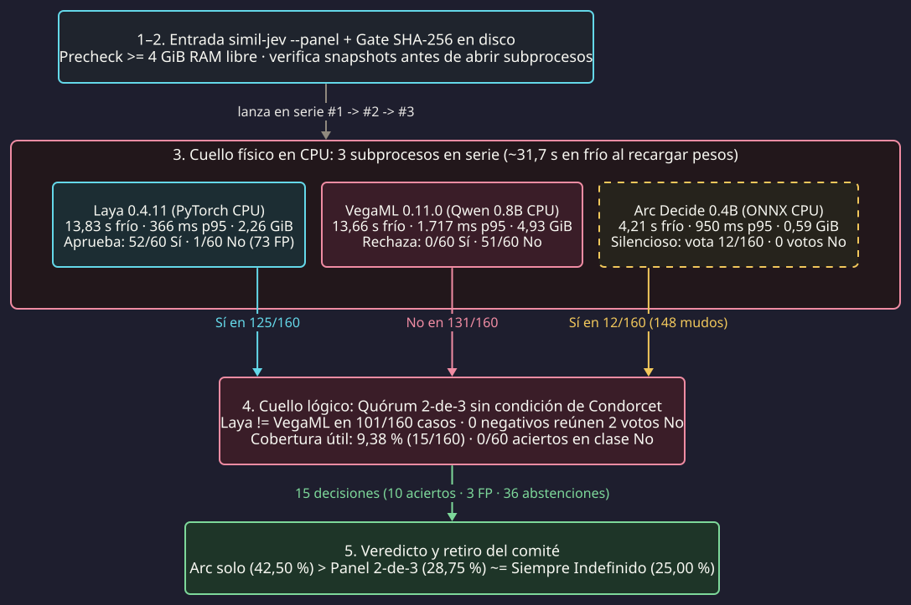
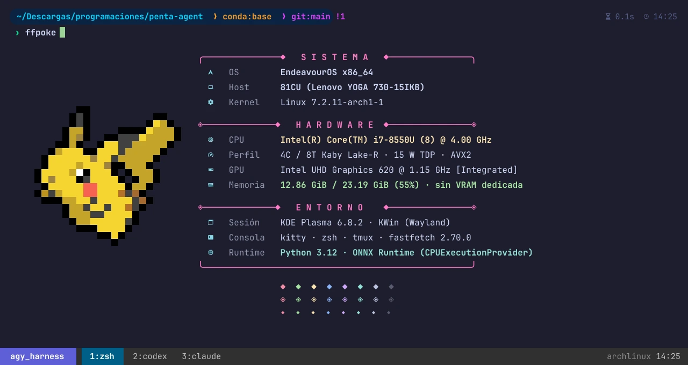

Cuando automatizo flujos de código y auditoría técnica, muchas validaciones no piden redactar texto: piden decidir rápido entre **"Sí"** (la evidencia alcanza), **"No"** (hay un fallo duro) o **"Indefinido"** (conviene abstenerse y escalar). Llamar a un LLM generativo en cada compuerta intermedia suma latencia, gasto de tokens y variabilidad innecesaria.

Por eso armé una prueba de concepto (*PoC*) llamada `simil-jev`: un **"comité de jueces olímpicos"** (`2-de-3`) corriendo en la CPU de mi portátil con tres modelos pequeños de `0,4B` a `0,8B` parámetros (**Laya**, **VegaML** y **Arc Decide**). Aquí muestro el precursor que inspiró la idea, la arquitectura de cada juez y por qué el comité acertó más cuando lograba acuerdo (`10` de `15`), pero terminó paralizado en el `90,62 %` de los casos.

---

## Cucharada 1: El precursor JEV y la promesa del "comité de jueces olímpicos"

La chispa de este prototipo vino de **[JEV Ultrafast](https://github.com/browser-use/jev-ultrafast)**, un experimento del equipo de *Browser Use* junto a *TypeSafe AI*. En vez de pedirle a un LLM pesado que mire capturas de pantalla o redacte párrafos en cada paso del navegador, `jev-ultrafast` convierte la página en una tabla indexada de controles y delega la elección en **[Jev](https://docs.typesafe.ai/introduction)**, un modelo especializado de decisión (*System 1*) que escoge la acción atómica (`CLICK`, `SELECT`, `WAIT`, `BLOCKED`) en milisegundos y solo llama a un LLM pequeño cuando necesita escribir texto (`TYPE_TEXT`).

  

    

      ⚡ JEV Ultrafast (Browser Use × TypeSafe AI)
    

    

      <a class="jev-chip" href="https://github.com/browser-use/jev-ultrafast" target="_blank" rel="noopener"><i class="fab fa-github"></i> browser-use/jev-ultrafast</a>
      <a class="jev-chip jev-chip--amber" href="https://docs.typesafe.ai/introduction" target="_blank" rel="noopener">TypeSafe Jev Docs</a>
    

  

  <video class="jev-showcase__video" width="1280" height="720" autoplay loop muted playsinline controls preload="metadata" poster="https://raw.githubusercontent.com/browser-use/jev-ultrafast/main/docs/demo.gif">
    <source src="https://raw.githubusercontent.com/browser-use/jev-ultrafast/main/docs/demo.mp4" type="video/mp4">
    
  </video>
  

    <strong>Precursor en acción:</strong> búsqueda Zúrich → Londres en Google Flights resuelta en <code>7,1 s</code> separando decisión atómica (Jev) de generación de texto (activo servido desde el repositorio oficial).
  

Como el motor *Jev* de TypeSafe opera detrás de una API remota y cerrada, quise comprobar si podía construir un equivalente 100 % local y abierto (`simil-jev`, *"símil de JEV"*) para mis compuertas de auditoría. Y como ningún modelo de menos de mil millones de parámetros es infalible por sí solo, decidí combinarlos bajo una arquitectura de **"comité de jueces olímpicos"** (`2-de-3` con derecho a abstención):

* **La promesa (Condorcet 1785; Dietterich 2000):** según el teorema del jurado de Condorcet, si cada juez acierta más de la mitad de las veces (`p > 0,5`) y sus errores son independientes, la mayoría se equivoca menos que cualquier juez individual.
* **La trampa olímpica:** en gimnasia o clavados el panel descarta las notas extremas sobre una escala continua, porque un juez sistemáticamente generoso o severo distorsiona el promedio. En un voto binario (`"Sí"` / `"No"` / `"Indefinido"`), en cambio, **un comité promedia ruido pero no corrige sesgos**: si dos jueces tiran hacia extremos opuestos, el comité no converge en la verdad, sino en la parálisis por falta de quórum.

---

## Cucharada 2: Los tres jueces en el banquillo y el doble cuello de botella en CPU

Para armar el comité seleccioné tres proyectos abiertos con arquitecturas radicalmente distintas entre sí. Antes de mirar el pipeline, vale la pena conocer qué hay dentro de cada uno y qué personalidad mostraron al evaluar mis `160` casos de prueba (`60` `"Sí"`, `60` `"No"` y `40` `"Indefinidos"`):

  

    

      

        
          
        
        

          Juez 1 · El que aprueba
          <h3 class="judge-card__title">Laya 0.4.11</h3>
        

      

      

        <a class="jev-chip" href="https://github.com/NandhaKishorM/laya" target="_blank" rel="noopener"><i class="fab fa-github"></i> GitHub</a>
        <a class="jev-chip" href="https://huggingface.co/convaiinnovations/laya-multilingual" target="_blank" rel="noopener">HF Model</a>
        <a class="jev-chip" href="https://huggingface.co/spaces/convaiinnovations/laya-demo" target="_blank" rel="noopener">Demo Space</a>
      

    

    

      

        Motor de decisión <em>System 1</em> no autorregresivo multilingüe entrenado con <em>strictly proper scoring rules</em> (RLCD) para emitir fallos en una sola pasada sin generar texto.
      

      

        
<strong>Costo CPU:</strong> <code>2,26 GiB</code> RAM · <code>13,83 s</code> frío · <code>366 ms</code> p95

        
<strong>Conducta en el panel:</strong> votó <strong>"Sí" en 125/160</strong> casos (incluidos <code>48</code> de los <code>60</code> negativos → <strong>73 falsos positivos</strong>).

      

    

  

  

    

      

        
          
        
        

          Juez 2 · El que rechaza
          <h3 class="judge-card__title">VegaML 0.11.0</h3>
        

      

      

        <a class="jev-chip jev-chip--rose" href="https://github.com/NandhaKishorM/vegaml" target="_blank" rel="noopener"><i class="fab fa-github"></i> GitHub</a>
        <a class="jev-chip jev-chip--rose" href="https://pypi.org/project/vegaml/" target="_blank" rel="noopener">PyPI 0.11.0</a>
        <a class="jev-chip jev-chip--rose" href="https://huggingface.co/Qwen/Qwen3.5-0.8B" target="_blank" rel="noopener"><code>Qwen</code> 0,8B</a>
      

    

    

      

        Combina un lector congelado (<code>Qwen</code> de <code>0,8B</code>) con un pequeño motor físico de <code>14,3M</code> de parámetros que proyecta estados en un paisaje de valles y simula una partícula con fricción hasta caer en una respuesta.
      

      

        
<strong>Costo CPU:</strong> <code>4,93 GiB</code> RAM · <code>13,66 s</code> frío · <code>1.717 ms</code> p95

        
<strong>Conducta en el panel:</strong> votó <strong>"No" en 131/160</strong> casos y acertó <strong>0 de 60</strong> en la clase "Sí".

      

    

  

  

    

      

        
          <svg width="20" height="20" viewBox="0 0 24 24" fill="none" stroke="currentColor" stroke-width="2" stroke-linecap="round" stroke-linejoin="round"><path d="M12 3v18"/><path d="M5 7h14"/><path d="M5 7l-3 6h6l-3-6z"/><path d="M19 7l-3 6h6l-3-6z"/><path d="M8 21h8"/></svg>
        
        

          Juez 3 · El silencioso
          <h3 class="judge-card__title">Arc Decide 0.4B</h3>
        

      

      

        <a class="jev-chip jev-chip--amber" href="https://huggingface.co/Arc53/arc-decide-0.4b-v0.2" target="_blank" rel="noopener">Arc53/arc-decide-0.4b</a>
        <a class="jev-chip jev-chip--amber" href="https://onnxruntime.ai/" target="_blank" rel="noopener">ONNX Runtime</a>
      

    

    

      

        Clasificador compacto de <code>0,4B</code> parámetros exportado a <strong>ONNX Runtime (<code>INT8</code>)</strong> para evaluar relevancia, contratos y compuertas binarias en menos de <code>1 GiB</code> de memoria.
      

      

        
<strong>Costo CPU:</strong> <code>0,59 GiB</code> RAM · <code>4,21 s</code> frío · <code>950 ms</code> p95

        
<strong>Conducta en el panel:</strong> con su umbral de panel (<code>0,66</code>) <strong>calló en 148/160</strong> casos; solo votó <code>12</code> veces (todas "Sí", <strong>0 votos "No"</strong>).

      

    

  

Cuando conecté los tres bajo el comando `simil-jev --panel`, aparecieron de golpe los dos cuellos de botella que retrata la **Figura 1**:

<figure class="cuch-d2-fig">
  <picture>
    <source media="(max-width: 640px)" srcset="/assets/images/jueces-locales-cpu/fig-d2-colapso-panel-mobile.svg">
    
  </picture>
  <figcaption>
    <strong>Figura 1.</strong> Pipeline real de <code>simil-jev --panel</code>. En la etapa 3 está el cuello físico (tres subprocesos en serie en CPU que suman <code>~31,7 s</code> en frío al recargar pesos en cada consulta) y en la etapa 4 el cuello lógico (Laya y VegaML chocan en <code>101/160</code> casos mientras Arc permanece mudo).
  </figcaption>
</figure>

En una estación con GPU dedicada y los tres motores residentes en VRAM, la etapa 3 tomaría milisegundos. Para dimensionar por qué en mi máquina ocurrió lo contrario, basta mirar la radiografía del equipo donde corrí el experimento (`ffpoke`, mi alias sobre `fastfetch` + `pokeget` en [`kitty`](https://github.com/kovidgoyal/kitty) y [`tmux`](https://github.com/tmux/tmux)):

<figure class="cuch-d2-fig">
  
  <figcaption>
    <strong>Máquina de prueba (<code>ffpoke</code> en <code>kitty</code> + <code>tmux</code>).</strong> Portátil <code>Lenovo YOGA 730-15IKB</code> con procesador <code>Intel Core i7-8550U</code> de <code>15 W</code> (<code>4</code> núcleos físicos / <code>8</code> hilos Kaby Lake-R con <code>AVX2</code>), gráfica integrada <code>Intel UHD 620</code> sin <code>CUDA</code> y <code>23,19 GiB</code> de RAM DDR4 sobre <code>EndeavourOS</code>.
  </figcaption>
</figure>

En ese `i7-8550U`, sin demonios residentes que secuestren `8 GiB` permanentes de RAM, levantar tres intérpretes de Python y PyTorch en serie costó unos **`31,7 s` en frío** y dejó a `Laya` y `VegaML` fuera de su meta de latencia p95 incluso en caliente. Y aun si hubiera tenido una GPU dedicada, el cuello lógico de la etapa 4 habría hundido igual al comité: **ningún juez superaba el `50 %` de acierto al decidir** (`41,41 %`, `40,80 %` y `47,42 %`), violando la primera condición de Condorcet antes de emitir el primer voto.

---

## Cucharada 3: Las papeletas del jurado y la paradoja del 66,67 %

Para ver por qué el comité acertó `10` de `15` cuando lograba acuerdo (`66,67 %` de exactitud selectiva) y aun así resultó inútil, basta abrir tres papeletas reales de mi banco de `240` casos (`80` de calibración y `160` de prueba):

  

    
Familia 1 · Precedencia contractual (Por qué desapareció el "No")

    
"Un borrador sin firma no reemplaza el dato firmado. El firmado dice <code>rojo</code> y el borrador, <code>verde</code>. ¿El valor vigente es <code>verde</code>?" → <strong>Respuesta correcta: "No"</strong>

    

      Laya: SÍ ✗
      VegaML: NO ✓
      Arc: ABSTENCIÓN (conf &lt; 0,66)
      Fallo 2-de-3: INDEFINIDO (Bloqueo)
    

  

  

    
Familia 2 · Evidencia directa (Cuando el desempate certifica un error)

    
"El hash esperado es <code>aa00</code> y el observado <code>bb11</code>. ¿Coinciden los hashes?" (<code>evidence_direct-14-v3</code>) → <strong>Respuesta correcta: "No"</strong>

    

      Laya: SÍ ✗
      VegaML: NO ✓
      Arc: SÍ ✗
      Fallo 2-de-3: SÍ (Falso Positivo)
    

  

  

    
Familia 3 · Ambigüedad e insuficiencia (Sesgo compartido)

    
"La fecha aparece como <code>04/05</code>, sin año ni convención regional. ¿Es el 4 de mayo de 2026?" (<code>negation_ambiguity_insufficient-18-v2</code>) → <strong>Respuesta correcta: "Indefinido"</strong>

    

      Laya: SÍ ✗
      VegaML: SÍ ✗
      Arc: ABSTENCIÓN
      Fallo 2-de-3: SÍ (Falso Positivo)
    

  

Esas tres papeletas resumen todo el experimento mejor que una sábana de números:

1. **El `"No"` era estructuralmente imposible (`0` aciertos de `60`):** para que el comité rechace algo necesita dos votos `"No"`. En los `60` casos negativos de prueba, `VegaML` votó `"No"` `53` veces, `Laya` apenas **`1` vez** y `Arc` **`0` veces**. Ningún caso negativo reunió jamás dos votos `"No"`: el juez severo no perdió la votación, **se quedó sin aliado**.
2. **La ilusión del `66,67 %`:** como `Laya` y `VegaML` votaron opuesto en `101` de los `160` casos y `Arc` permaneció callado en `148`, el comité solo emitió veredicto en **`15` casos (`9,38 %` de cobertura)**. Acertó `10` de esos `15` (`66,67 %`, con un intervalo de Wilson al 95 % de `41,7 %` a `84,8 %`), pero concentrados en apenas `4` de las `40` familias tras haber sobreajustado umbrales en calibración (`14/14`).
3. **Callar vestía de acierto la métrica global:** en exactitud de tres clases (`"Sí"`, `"No"`, `"Indefinido"`), el comité marcó `28,75 %` (`46/160`), pero `36` de esos `46` aciertos fueron simplemente sus abstenciones cayendo sobre los `40` casos `"Indefinidos"`. Un script vacío que responda siempre `"Indefinido"` ya obtiene **`25,00 %`** sin gastar RAM ni esperar medio minuto:

  <h4 class="scoreboard__title">Marcador final en los 160 casos de prueba (60 "Sí" · 60 "No" · 40 "Indefinidos")</h4>
  
Contraste entre el acierto cuando el evaluador se atreve a decidir (exactitud selectiva + cobertura) y la exactitud global de tres clases.

  

    

      <strong>🏆 Arc Decide 0.4B (solo)</strong> — El mejor individual
      <code>0,59 GiB</code> · <code>4,21 s</code> frío · <code>49</code> FP · <code>5/60</code> en "No"
    

    

      

        
Acierto al decidir (cobertura 60,63 %)<strong>47,42 %</strong>

        

      

      

        
Exactitud 3-clases (68/160)<strong>42,50 %</strong>

        

      

    

  

  

    

      <strong>Laya 0.4.11 (solo)</strong> — El optimista
      <code>2,26 GiB</code> · <code>13,83 s</code> frío · <code>73</code> FP · <code>52/60</code> en "Sí"
    

    

      

        
Acierto al decidir (cobertura 80,00 %)<strong>41,41 %</strong>

        

      

      

        
Exactitud 3-clases (66/160)<strong>41,25 %</strong>

        

      

    

  

  

    

      <strong>VegaML 0.11.0 (solo)</strong> — El pesimista
      <code>4,93 GiB</code> · <code>13,66 s</code> frío · <code>4</code> FP · <code>51/60</code> en "No"
    

    

      

        
Acierto al decidir (cobertura 78,13 %)<strong>40,80 %</strong>

        

      

      

        
Exactitud 3-clases (61/160)<strong>38,13 %</strong>

        

      

    

  

  

    

      <strong>⚖️ Comité 2-de-3 (Laya + VegaML + Arc)</strong> — Parálisis por sesgos opuestos
      <code>~31,7 s</code> en serie · <code>3</code> FP · <strong><code>0/60</code> en "No"</strong>
    

    

      

        
Acierto al decidir (10/15 · cobertura 9,38 %)<strong>66,67 %</strong>

        

      

      

        
Exactitud 3-clases (36 de 46 son abstenciones)<strong>28,75 %</strong>

        

      

    

  

  

    

      <strong>Baseline trivial: responder siempre "Indefinido"</strong>
      <code>0,00 GiB</code> · <code>0 ms</code> · <code>0</code> FP
    

    

      

        
Acierto al decidir (cobertura 0,00 %)<strong>no aplica</strong>

        

      

      

        
Exactitud 3-clases (40/160 aciertos gratis)<strong>25,00 %</strong>

        

      

    

  

---

## Cierre de investigación: qué modelo libre sí corre en milisegundos en mi i7-8550U

¿Cuándo tendría sentido armar un comité de clasificadores tipo JEV? Cuando cada juez supere el `50 %` de acierto en cada clase sobre datos fuera de muestra (Condorcet 1785), cuando sus errores estén desacoplados (Dietterich 2000), cuando sus probabilidades estén calibradas (Guo et al. 2017) y cuando al menos dos jueces tengan sensibilidad real para votar `"No"`. Juntar en CPU a un juez que aprueba casi todo, otro que rechaza casi todo y un tercero que casi no habla no produce sabiduría colectiva: produce abstención cara. Por eso retiré el prototipo.

Pero retirar ese comité deja abierta la pregunta práctica: **¿existe hoy un modelo local, 100 % libre y gratuito, que sí pueda decidir compuertas de tres clases (`"Sí"`, `"No"`, `"Indefinido"`) en milisegundos sobre un `Intel Core i7-8550U` sin GPU?** Sí existe, siempre que cambie de familia arquitectónica y deje de tratar una verificación lógica como si fuera un problema de generación de texto.

Cuando una compuerta evalúa si una evidencia observada respalda, contradice o resulta insuficiente frente a una regla, el problema formal no es *causal language modeling*, sino **inferencia de lenguaje natural (*Natural Language Inference*, NLI)** de tres clases: *entailment* (`"Sí"`), *contradiction* (`"No"`) y *neutral* (`"Indefinido"`). En esa categoría, el modelo abierto que mejor equilibra precisión y velocidad en una CPU portátil con `AVX2` es **[`MoritzLaurer/DeBERTa-v3-small-mnli-fever-anli`](https://huggingface.co/MoritzLaurer/DeBERTa-v3-small-mnli-fever-anli)** (Laurer et al. 2024), basado en la arquitectura **DeBERTaV3** (He, Gao y Chen 2023) y compilado a **ONNX INT8** mediante [`optimum`](https://github.com/huggingface/optimum) y [`onnxruntime`](https://onnxruntime.ai/):

  

    <h3 class="nli-solution-card__title">✅ Alternativa viable en CPU: DeBERTa-v3-small-mnli-fever-anli (ONNX INT8)</h3>
    

      <a class="jev-chip" href="https://huggingface.co/MoritzLaurer/DeBERTa-v3-small-mnli-fever-anli" target="_blank" rel="noopener">HF Model (MIT)</a>
      <a class="jev-chip jev-chip--amber" href="https://arxiv.org/abs/2111.09543" target="_blank" rel="noopener">Paper DeBERTaV3</a>
      <a class="jev-chip" href="https://onnxruntime.ai/" target="_blank" rel="noopener">ONNX Runtime</a>
    

  

  

    <em>Cross-encoder</em> bidireccional con <strong>atención desenredada</strong> (<em>disentangled attention</em>, que separa contenido y posición relativa) entrenado mediante <em>replaced token detection</em> (ELECTRA) y ajustado sobre <strong>763.913 pares NLI</strong> (<code>MultiNLI</code> + <code>FEVER-NLI</code> + <code>ANLI</code> R1–R3). Evalúa premisa e hipótesis juntas en una sola pasada hacia adelante sin cargar PyTorch.
  

  

    

      <strong>5 a 15 ms por veredicto</strong>
      En un procesador portátil con <code>AVX2</code> sobre <code>onnxruntime</code> (<code>INT8</code> dinámico), frente a los <code>366–1.717 ms</code> en caliente y <code>~31,7 s</code> en frío del comité.
    

    

      <strong>~140 MiB en disco y RAM</strong>
      <code>44M</code> de parámetros en el <em>backbone</em> (<code>142M</code> totales con vocabulario), casi <code>60 veces</code> más liviano que los <code>8,36 GiB</code> que ocupaban los tres jueces.
    

    

      <strong>3 clases nativas ("Sí" / "No" / "Indefinido")</strong>
      Emite logits directos para <code>entailment</code>, <code>contradiction</code> (<code>88,0 %</code> en MNLI-m) y <code>neutral</code>, eliminando de raíz la ceguera al <code>"No"</code> (<code>0/60</code>).
    

  

La lección que me llevo de esta prueba de concepto es simple: en un portátil de trabajo sin aceleradora dedicada, **un único *cross-encoder* NLI pequeño, bien calibrado y compilado a ONNX INT8 supera en velocidad, huella de memoria y sensibilidad para decir `"No"` a cualquier comité de modelos mal acoplados**. Cuando la verificación es determinista (un hash, un esquema JSON o un código de salida), una regla de código en `0 ms` sigue siendo imbatible; y cuando realmente hace falta juzgar implicación o contradicción semántica en local, la respuesta no estaba en sumar tres jueces en serie, sino en elegir la arquitectura correcta para una CPU.

---

## Referencias

- Arc53. 2025. *"arc-decide-0.4b-v0.2: Compact ONNX Decision Classifier"*. Repositorio de modelo en Hugging Face. [https://huggingface.co/Arc53/arc-decide-0.4b-v0.2](https://huggingface.co/Arc53/arc-decide-0.4b-v0.2).
- Browser Use y TypeSafe AI. 2026. *"JEV Ultrafast: Sub-Second Browser Agent Actions with Jev Decision Models"*. Repositorio oficial en GitHub. [https://github.com/browser-use/jev-ultrafast](https://github.com/browser-use/jev-ultrafast).
- Condorcet, Jean-Antoine-Nicolas de Caritat, Marqués de. 1785. [*Essai sur l'application de l'analyse à la probabilité des décisions rendues à la pluralité des voix*](https://gallica.bnf.fr/ark:/12148/bpt6k417181). París: Imprimerie Royale.
- Dietterich, Thomas G. 2000. ["Ensemble Methods in Machine Learning"](https://doi.org/10.1007/3-540-45014-9_1). En *Multiple Classifier Systems (MCS 2000)*, Lecture Notes in Computer Science, vol. 1857, 1–15. Berlín: Springer.
- Guo, Chuan, Geoff Pleiss, Yu Sun y Kilian Q. Weinberger. 2017. ["On Calibration of Modern Neural Networks"](https://proceedings.mlr.press/v70/guo17a.html). En *Proceedings of the 34th International Conference on Machine Learning (ICML)*, PMLR 70: 1321–1330.
- He, Pengcheng, Jianfeng Gao y Weizhu Chen. 2023. ["DeBERTaV3: Improving DeBERTa using ELECTRA-Style Pre-Training with Gradient-Disentangled Embedding Sharing"](https://arxiv.org/abs/2111.09543). En *International Conference on Learning Representations (ICLR 2023)*.
- Laurer, Moritz, Wouter van Atteveldt, Andreu Casas y Kasper Welbers. 2024. ["Less Annotating, More Classifying: Addressing the Data Scarcity Issue of Supervised Machine Learning with Deep Transfer Learning and BERT-NLI"](https://doi.org/10.1017/pan.2023.20). *Political Analysis* 32 (1): 84–100. Modelo: [https://huggingface.co/MoritzLaurer/DeBERTa-v3-small-mnli-fever-anli](https://huggingface.co/MoritzLaurer/DeBERTa-v3-small-mnli-fever-anli).
- NandhaKishorM (ConvAI Innovations). 2026a. *"Laya: System 1 Non-Autoregressive Multilingual Decision Engine"*. Repositorio en GitHub. [https://github.com/NandhaKishorM/laya](https://github.com/NandhaKishorM/laya).
- NandhaKishorM. 2026b. *"VegaML: Potential-Well Physics Decision Engine over Frozen Language Backbones"*. Repositorio en GitHub. [https://github.com/NandhaKishorM/vegaml](https://github.com/NandhaKishorM/vegaml).

